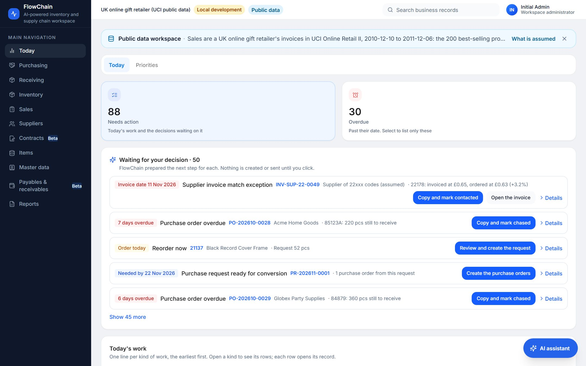
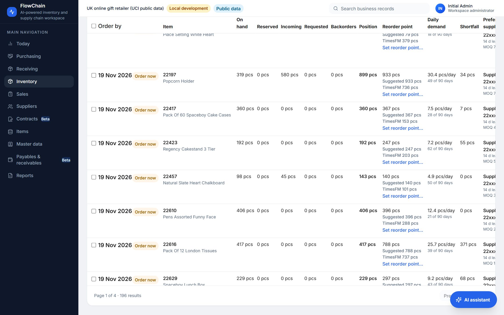
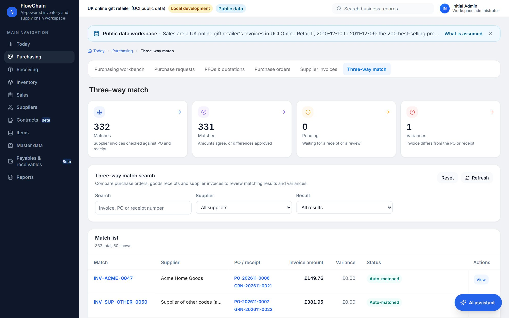
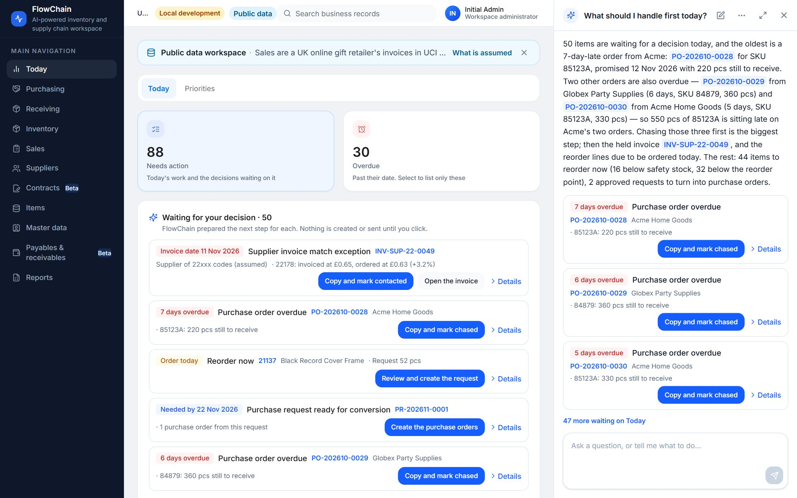
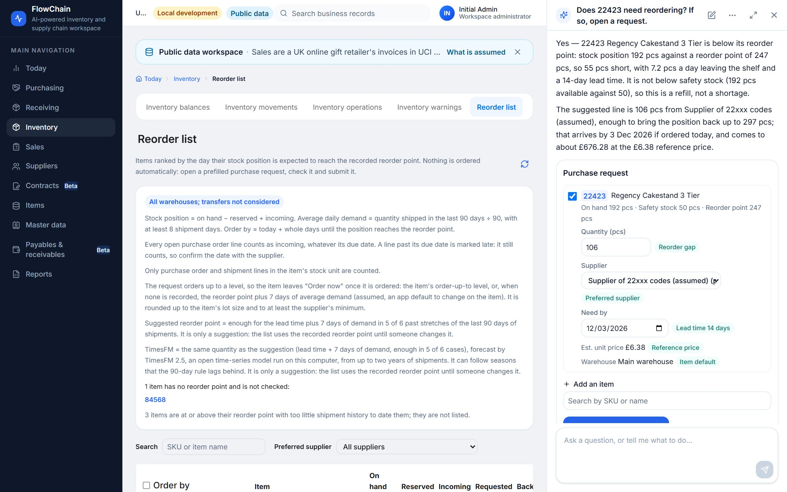
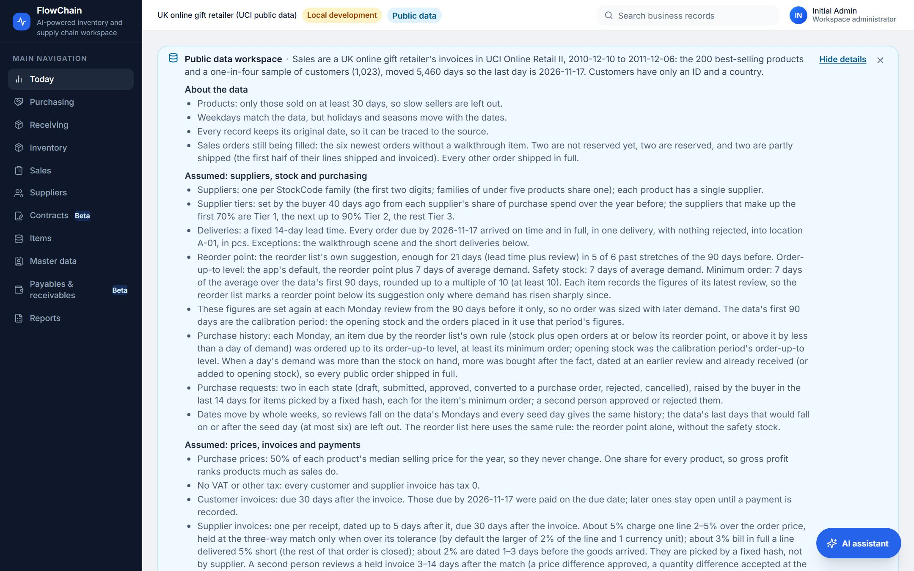

# FlowChain demonstration

A ten-minute walkthrough of the UCI workspace (a UK online gift retailer, public sales data, assumed purchasing side). Figures are as of the 18 November 2026 seed; the data moves with the calendar, so a later run shows slightly different numbers.

## 1 Today — 2 minutes

Open Today. The cards under *Waiting for your decision* are next steps the system has already drafted from rules: an invoice difference (INV-SUP-22-0049, 22178 invoiced at £0.65 against £0.63 ordered, +3.2%), a late order (PO-202610-0028 from Acme, 220 pcs of 85123A still to receive), a reorder, and an approved request ready to convert.

Point out: nothing happens until someone clicks. *Copy and mark chased* copies a reminder and records the chase; the person sends it.

## 2 Why not reorder the item that is short — 2 minutes

Open item 85123A (White Hanging Heart T-Light Holder): 48 on hand against a safety stock of 111 and a reorder point of 522. Two late Acme orders still bring 550 pcs, so its position (598) is above the reorder point and the reorder list does not suggest another order. The right action is to chase, not to order twice.

## 3 Reorder — 2 minutes

Inventory → Reorder list. Find 22423 Regency Cakestand 3 Tier: 192 on hand, reorder point 247, nothing on order. *Create purchase request* opens a prefilled request for 106 pcs, ordering up to the reorder point plus seven days of demand (an app default marked *assumed* on the row). A person checks and submits it.

## 4 Approval and matching — 2 minutes

Purchase orders → PO-202611-0021 is waiting for approval; its submitter cannot approve it. Then open Three-way match: 331 invoices matched and 1 held. Open INV-SUP-22-0049 to show the line comparison of ordered, received and invoiced quantities and prices. The difference is above the tolerance (the larger of 2% and £1 a line), so it is held and is not payable until a second person reviews it.

## 5 The assistant — 2 minutes

Open the assistant from any page and ask, in English or Chinese:

- *What should I handle first today?*
- *Does 85123A need reordering?*
- *Draft a reminder to Acme listing its late orders.*

Show the cited records under each answer, the form or draft it prepares, and that the person confirms every step. Each answer can be rated 👍 or 👎; a thumbs-down becomes a draft test case.

## 6 What is assumed — 30 seconds

Open *What is assumed* in the blue bar at the top. It lists what comes from the public data and what is generated by stated rules (suppliers, costs, lead times, invoice differences), computed from past data only.

## Screenshot index

| Screenshot | What it shows |
| --- | --- |
| [01 Today](assets/01-today-decisions.jpg) | Drafted decisions waiting for a person, with the work queue |
| [02 Reorder list](assets/02-reorder-list.jpg) | Order-by dates, the order-up-to quantity, the optional TimesFM line |
| [03 Three-way match](assets/03-three-way-match.jpg) | Matched invoices and the one held by a price difference |
| [04 Assistant, today](assets/04-assistant-today.jpg) | An answer on what to handle first, with the records it used |
| [05 Assistant, reorder](assets/05-assistant-reorder-form.jpg) | An answer that opens a prefilled purchase request for a person to submit |
| [06 What is assumed](assets/06-what-is-assumed.jpg) | The labelled assumptions behind the public-data workspace |

All records come from the public-data workspaces seeded on 18 November 2026 from FlowChain `main` at `df9f3260`. Supplier names other than the code-based groups (Acme Home Goods, Globex Party Supplies) are fictional.
