# FlowChain

**An AI-assisted procurement, inventory, and sales workspace for SMEs, built by Zhixin Chen.**

FlowChain connects purchasing, stock availability, supplier commitments, and the records behind them. Its conversational assistant helps users understand what needs attention, inspect supporting evidence, and prepare the next piece of work for human review.

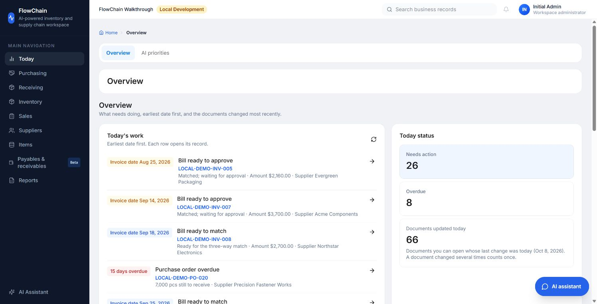

*Actual application screenshots captured in an isolated workspace with fictional suppliers and transactions. This repository presents the product and recorded evaluation evidence.*

[AI conversation assistant](#ai-conversation-assistant) · [Mobile operations](#mobile-operations--beta) · [Purchasing and inventory](#purchasing-and-inventory-in-action) · [Demo walkthrough](DEMO.md)

## AI conversation assistant

The assistant is a conversation interface inside the business workspace. Users can ask a question, inspect the records behind the answer, continue with a follow-up, and review a proposed next action.

| Capability | Business example |
| --- | --- |
| Natural-language business questions | “Which purchase orders are overdue?” or “What should I handle first today?” |
| Record lookup and follow-up context | Ask about a PO, SKU, or supplier, then continue from the records cited in the previous answer. |
| Purchasing spend analysis | Review committed purchasing spend by supplier, item, or month using the purchasing dashboard's calculations. |
| Procurement and inventory decisions | Check available stock and incoming orders before preparing a purchase-request draft. Existing orders that cover a shortage are surfaced first. |
| Supplier follow-up drafts | Prepare a message with outstanding quantities and promised dates for a person to review. |
| Product and company knowledge | Search uploaded guides and policies with passage citations; optional semantic retrieval extends keyword search. |
| English and Chinese conversations | Answer in the language used for the question while preserving business values and record IDs. |

### From a question to supporting records

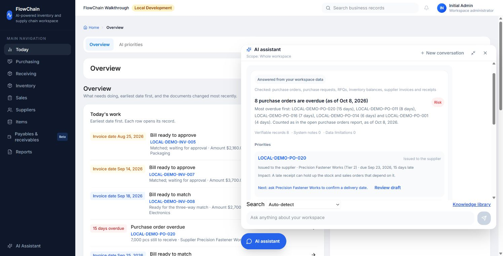

*Actual demo query: “Which purchase orders are overdue?” The assistant identifies eight overdue orders in the fictional workspace and prioritizes the oldest. It names the records checked, the supplier, the promised date, and a suggested follow-up.*

### From an answer to a reviewable draft

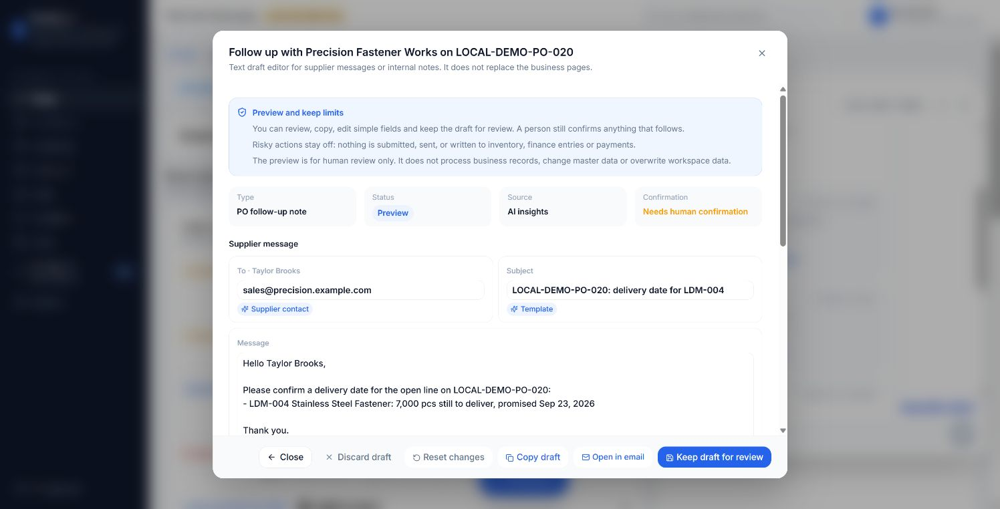

*The draft for LOCAL-DEMO-PO-020 includes the outstanding 7,000 pcs and the promised date. The user can inspect and edit the message before taking the next step.*

The assistant uses deterministic, read-only business services by default. An optional language model can plan tool calls and word answers; its numbers, record IDs, and dates are checked against the underlying records. These screenshots show the default mode without an external language model. Model-assisted wording and semantic retrieval are supported options rather than capabilities demonstrated by these images.

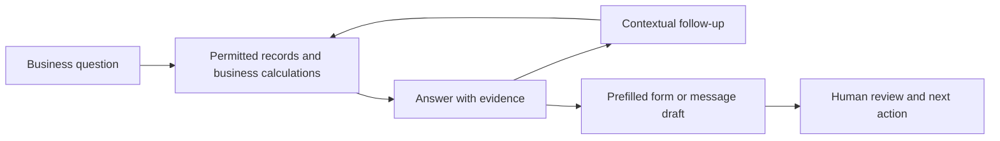

The assistant does not autonomously save, submit, approve, pay, or send messages. Formal business actions remain in the relevant document pages.

## Mobile operations — beta

FlowChain also has **responsive web pages for mobile operations**: a task inbox, purchase-order review, and receiving preparation. They use the same business services and authorization checks as the desktop workspace.

<table>
  <tr>
    <th>Task inbox</th>
    <th>Purchase-order review</th>
    <th>Receiving preparation</th>
  </tr>
  <tr>
    <td>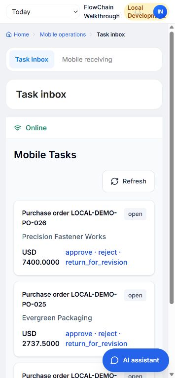</td>
    <td>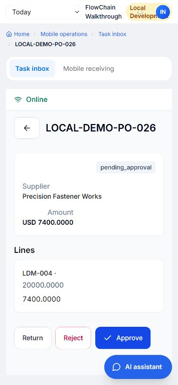</td>
    <td>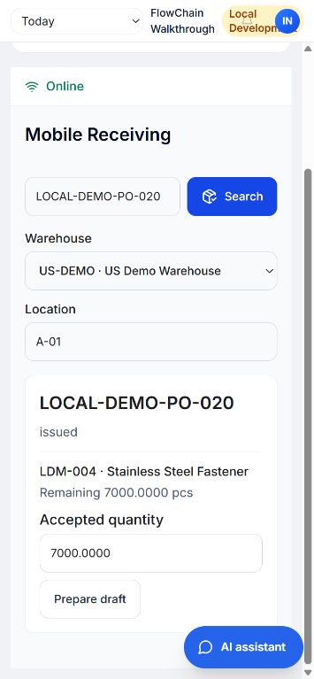</td>
  </tr>
</table>

- **Task inbox:** see purchasing work awaiting a decision and open its document.
- **PO review:** inspect the supplier, amount, and lines; the beta interface exposes return, reject, and approve actions.
- **Receiving preparation:** search an issued PO, choose a warehouse and location, review outstanding quantities, and prepare a receipt draft.

**Status:** this module is implemented as a beta capability that requires explicit enablement. It is disabled by default and outside the current core trial scope. It was enabled in the isolated walkthrough used for these screenshots. The images demonstrate the web interfaces; no approval or receipt was posted during capture. This is a responsive web module, rather than a native iOS or Android application. These images do not establish native-device or offline readiness.

## Purchasing and inventory in action

### RFQs and supplier quotation comparison

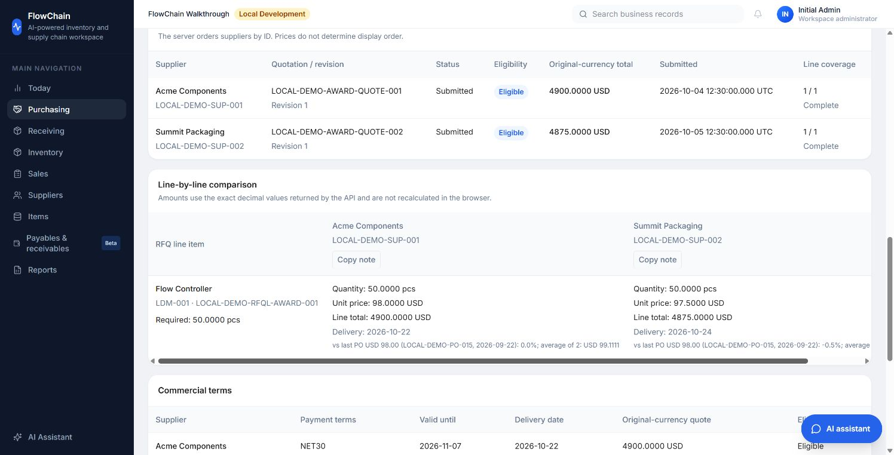

*Two recorded quotations are compared by quantity, unit price, total, and delivery date, with earlier PO prices available as context. Commercial terms support the buyer's review. A formal award is a separate, authorized human decision; the comparison does not automatically rank suppliers or create a PO.*

### Inventory visibility and replenishment

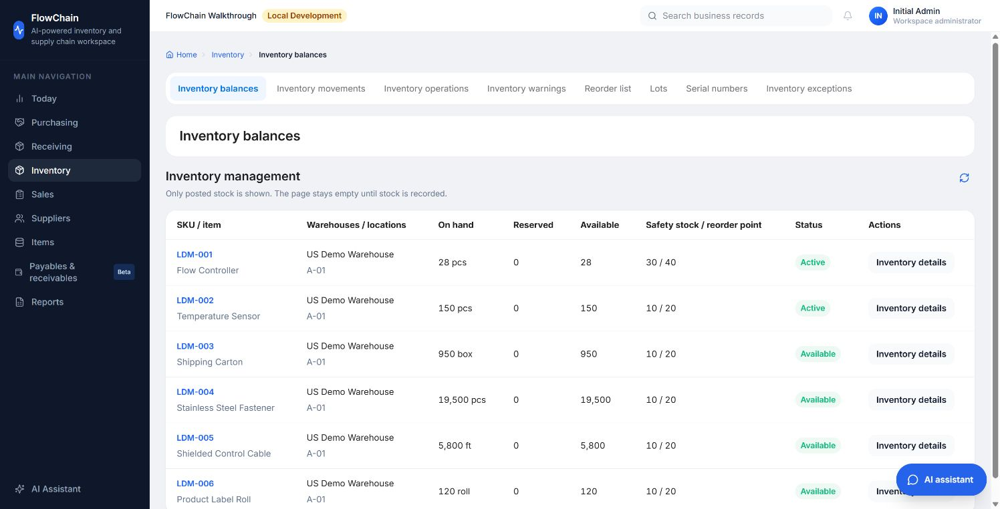

*Posted inventory shows on-hand, reserved, and available quantities alongside safety stock and reorder points.*

The reorder list combines stock and remaining quantities on committed POs. With sufficient history, it uses 90 days of posted shipments to estimate daily demand and calculate an order-by date. Incoming orders due after that date are excluded and the date is recalculated. Supplier minimum order quantities are considered when prefilling a request. Missing history and incompatible units are shown explicitly.

The pictured walkthrough has no qualifying reorder rows: its stock positions, including incoming POs, are above the recorded reorder points, and shipment history is insufficient to date future requirements. The inventory screenshot demonstrates stock visibility; it does not show a generated replenishment recommendation.

### Supplier delivery performance

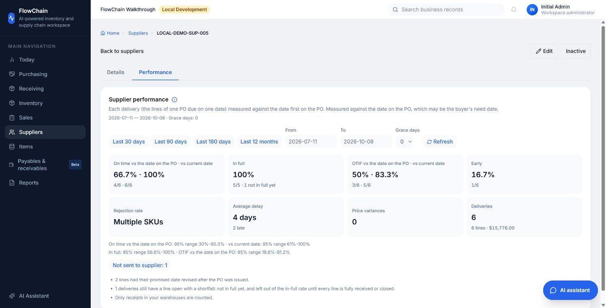

*The scorecard distinguishes the original PO date from the current revised date. In this fictional example, on-time delivery is 66.7% against the original date and 100% against the current date. Keeping both visible prevents revised promises from concealing the original delay.*

Supplier scorecards also show in-full, OTIF, early delivery, average delay, delivery counts, and data limitations, with supporting PO and receipt records available for inspection.

## Product coverage

| Area | Implemented workflows |
| --- | --- |
| Purchasing | Requests, RFQs, quotation revisions, reviewed awards, PO approval and issue, historical price context, and promised-date change reasons |
| Receiving | Receipt drafts, impact previews, posting, and reversals |
| Inventory | Balances, movements, availability, reservations, transfers, cycle counts, adjustments, lots, serials, and reorder decisions |
| Suppliers | Commercial terms, item relationships, tiers and owners with reasons, purchase records, delivery performance, and open issues |
| Sales | Customer orders, confirmation, holds, reservations, shipments, and invoicing |
| Operational finance | Supplier bills, three-way matching, payables, receivables, credit notes, and records of externally made payments |
| Data and reports | Master data, CSV/XLSX import, operational dashboards, report catalog, and exports |
| AI and knowledge | Business conversation, evidence links, record follow-ups, spend analysis, drafts, and document retrieval with citations |
| Mobile operations | Explicitly enabled beta web task inbox, PO review, and receiving preparation; outside current core trial scope |

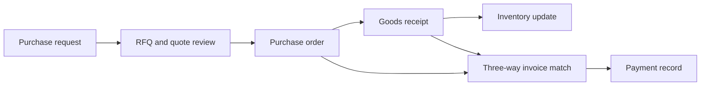

Not every purchase requires an RFQ. Payments made outside FlowChain are recorded in the system rather than executed by it. Operational finance does not replace a general ledger or statutory accounting system. Demand forecasting and MRP remain outside the current product release.

## Recorded evaluation evidence

The assistant evaluation set contains **255 questions in English and Chinese**, covering business routing, numeric agreement, record lookup, follow-up context, permissions, tenant isolation, and draft preparation.

The recorded baseline dated **October 7, 2026** requires **225 cases to pass**. Project documentation reports that all 225 pass, with no permission leaks, cross-tenant leaks, or business writes in that evaluation. The remaining 30 cases are scored separately and are not part of the required gate; they include model-dependent planning, paraphrases, and semantic retrieval. A separate set of **18 knowledge questions** checks document and section retrieval.

These are recorded project results, not a fresh evaluation run for this showcase update. They apply to the defined suites and do not establish universal model accuracy or customer savings. The demo record counts and scorecard values in the screenshots are fictional scenario data, not adoption or performance metrics.

## My contribution and implementation

I developed FlowChain as an independent project, translating procurement and inventory requirements into connected workflows. My work includes replenishment rules, supplier performance, RFQ comparison, a conversational assistant grounded in business records, a mobile web operations module, and evaluation cases that check behavior against known data.

The application uses React, Node.js, PostgreSQL, and Prisma. Business services calculate quantities and amounts; the optional language model supports read-only tool planning and checked answer wording. The knowledge library supports document retrieval with citations. English is the default interface and Chinese is available; translation work is ongoing.

See the [demo walkthrough and screenshot index](DEMO.md) for a guided presentation.

---

Prepared from the FlowChain main-branch snapshot `33542e12` on October 8, 2026. Screenshots use fictional records from an isolated local walkthrough. This showcase contains documentation and selected images; application source, credentials, and operational data are not included.
