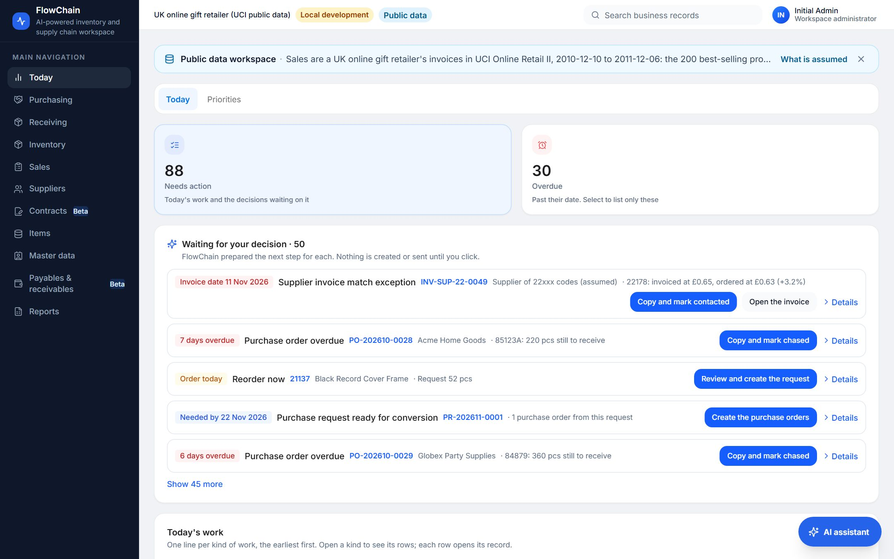
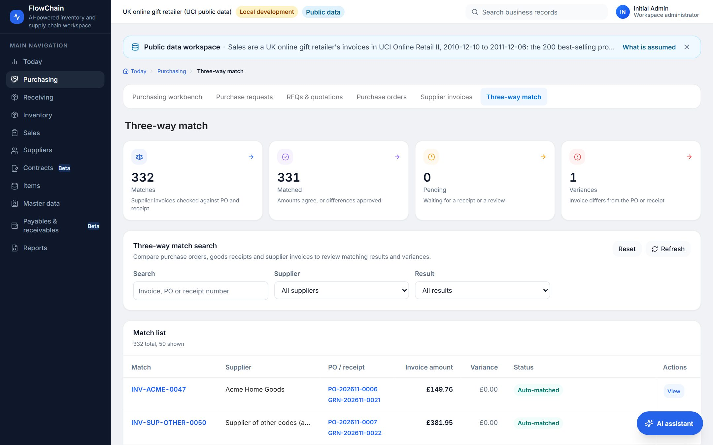
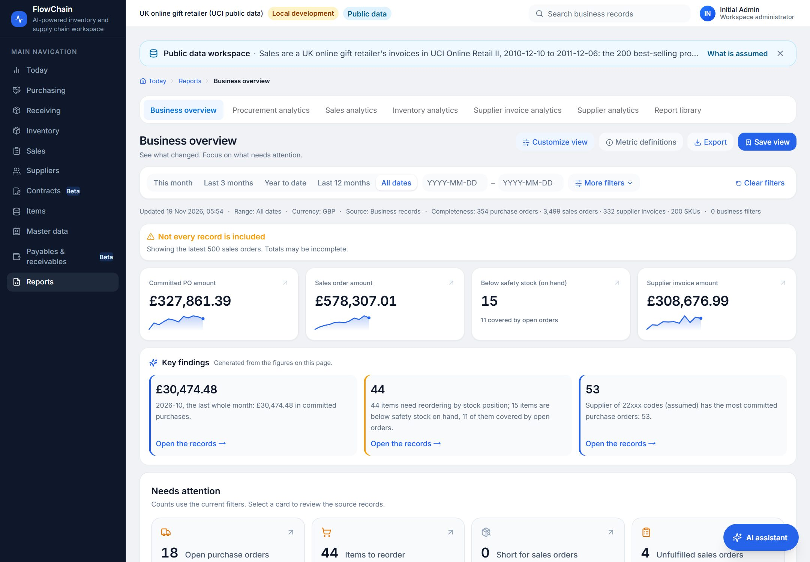
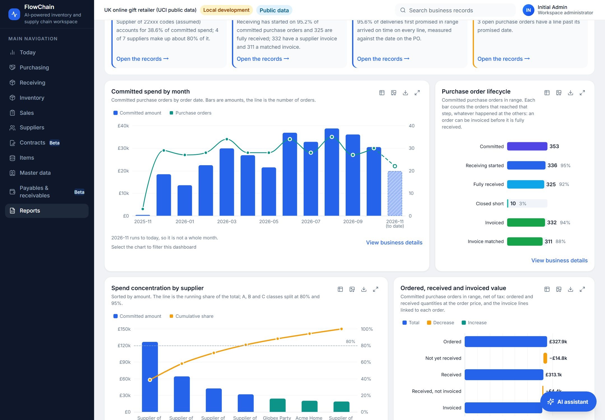
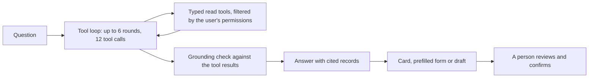
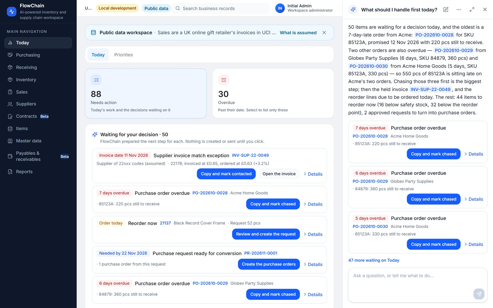
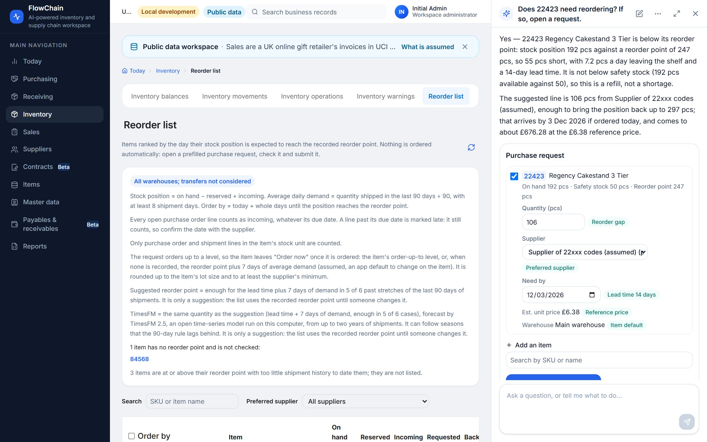
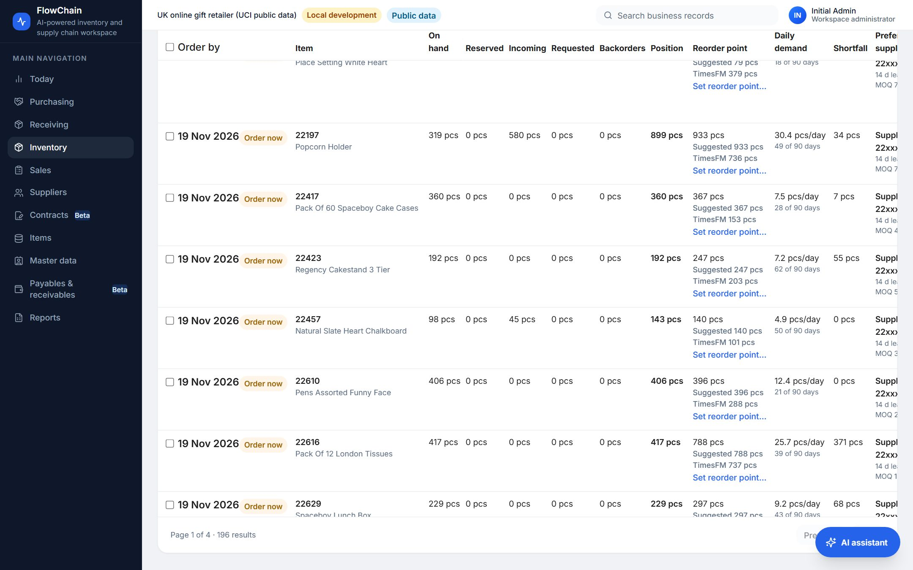
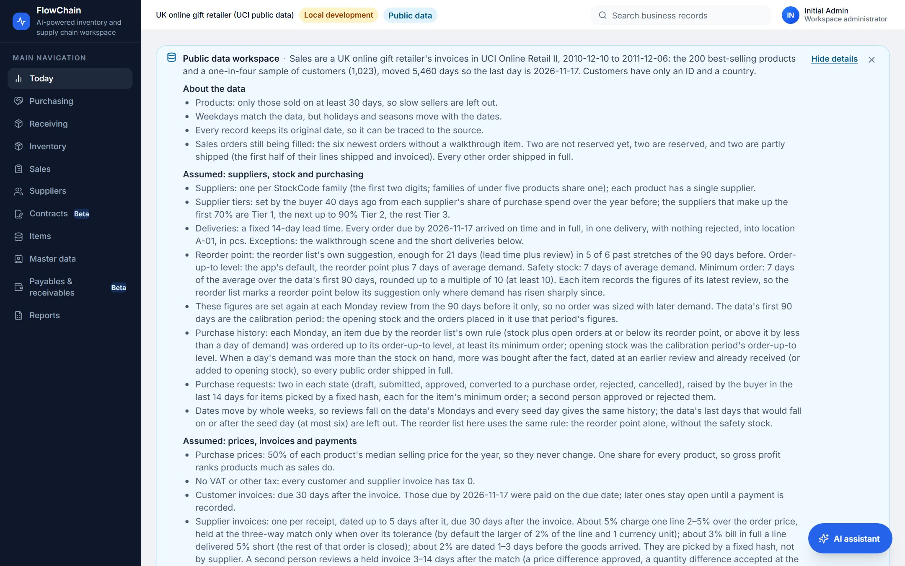

# FlowChain

**An AI procurement research prototype: a purchase-to-pay and inventory workspace with an LLM agent that reads the records, cites them, and prepares the next step for a person to confirm. Built by Zhixin Chen.**

FlowChain runs on two public datasets with labelled assumptions: UCI Online Retail II (a UK online gift retailer, GBP) and M5 (Walmart store CA_1, USD). There is no customer data and no production deployment. The question it is built to study is the one every agent deployment has to answer: which steps should be fixed rules, which can be left to the model, and where a person has to decide.

*Today in the UCI workspace. Each card is a drafted next step (chase a late order, review an invoice difference, reorder, convert an approved request). Nothing is created or sent until someone clicks.*

[What the workspace does](#what-the-workspace-does) · [How the agent works](#how-the-agent-works) · [Fitting an agent into a workflow](#fitting-an-agent-into-a-workflow) · [Evaluation](#evaluation) · [Limits](#limits) · [Demo walkthrough](DEMO.md) · [Research notes](RESEARCH.md)

## What the workspace does

A multi-tenant web app (TypeScript, React, Node.js, PostgreSQL) covering the purchase-to-pay flow and the stock it depends on.

| Area | What a user can do |
| --- | --- |
| Purchasing | Purchase requests with approval, RFQs and supplier quote comparison, purchase orders (submit, approve, issue), a preview of the orders an approved request will create |
| Receiving | Receipt drafts, a preview of the stock impact, posting and reversal |
| Matching and payables | Three-way match of order, receipt and supplier invoice per line; differences inside the tolerance match automatically, the rest are held until a second person reviews them; payables aging with held invoices shown apart |
| Inventory | Balances, movements, warnings, and a reorder list ranked by order-by date, with batch requests and an optional TimesFM forecast line |
| Sales | Orders, reservations, one-click full shipment, customer invoices, receivables |
| Suppliers | Delivery performance (on time, in full, OTIF against the original promised date), tiers set by people with reasons, risks |
| Reports | Dashboards whose figures open the exact rows they count, exports, printable documents with page numbers |

Approvals follow segregation of duties: the person who submitted a request or order cannot approve it (a workspace with a single approver is the one logged exception). The match tolerance is the larger of 2% and one currency unit per line, with zero tolerance on quantity; a quantity difference can be rejected, matched again after a late receipt, or accepted at the received quantity, but never approved for payment as invoiced.

*332 supplier invoices checked against their orders and receipts: 331 matched, 1 held by a price difference above the tolerance.*

### Dashboards

Six dashboards (business overview, procurement, sales, inventory, supplier invoices, suppliers) plus a report library and builder. Every figure opens the exact records it counts, the date range and filters apply to every figure on the page, each figure has a written definition, and views can be saved and exported. *Key findings* are written from the figures on the page, not by a model, and a notice says when a figure rests on incomplete records.

*Business overview: committed purchasing, sales, stock below safety level (and how much of it open orders already cover), supplier invoices, and what needs attention.*

*Procurement analytics: committed spend by month, the purchase order lifecycle from commitment to matched invoice, spend concentration by supplier (ABC), and ordered against received and invoiced value.*

## How the agent works

The assistant opens on every page and answers questions about the whole workspace in English or Chinese.

- **Read tools with schemas.** The model reads through typed tools: purchasing, inventory, sales, supplier and finance reads, a `calculate` tool for arithmetic and dates, and `search_documents` over a policy and knowledge library (LangChain text splitting, pgvector retrieval, cited passages). Every tool declares a JSON Schema; arguments outside it are rejected. A tool is offered only if the asking user may read its source, so the agent cannot see more than the user.
- **Grounding check.** Before an answer is shown, the server checks every figure, date, record number and supplier, customer or item name in it against that answer's tool results, the `calculate` results, or the question. Anything it cannot trace is flagged. Sentences that claim the assistant did something it cannot do are removed.
- **No writes by the model.** The agent has no write tool. It can open a purchase request form prefilled with quantities, draft a reminder to a supplier about an overdue order, or offer the app's own buttons. A person checks and confirms each one; a supplier email needs the text and then the address confirmed, and a retried send goes out once.
- **An optimiser where a rule is not enough.** For an order plan under a budget, the agent calls an exact MILP solver (sample-average approximation, solved with HiGHS). Its quantities go into the purchase request form, where a person reviews them.
- **Rules where the answer must not vary.** The drafted decisions on Today (chase, reorder, review a difference, convert a request) come from rules and a small state machine, not from the model. A decision someone has made is remembered, and the card comes back only if the situation changes.
- **Budgets.** Each answer is capped in rounds, tool calls, tokens and cost, and long conversations keep only as many earlier turns as the budget allows.

*"What should I handle first today?" The answer starts from the oldest late order, notes that 550 pcs of 85123A sit on two late Acme orders, and lists the held invoice and the reorders due today. The records it used are listed under the answer.*

*"Does 22423 need reordering? If so, open a request." The answer explains the position against the reorder point and opens a purchase request prefilled with 106 pcs, the supplier and the need-by date. Nothing is saved until a person submits it.*

*The reorder list counts every open purchase order line as incoming, flags late ones, and orders up to a level. The TimesFM line is an optional forecast shown next to the rule-based suggestion, not a replacement for it.*

## Fitting an agent into a workflow

In the terms agent platforms use:

| Part | In FlowChain |
| --- | --- |
| Integration | CSV/XLSX import with a preview before commit; supplier email sent through a mail provider only after a person confirms it. No ERP connector; reading supplier replies is designed, not built. |
| Tool | Typed read tools with JSON Schemas, offered per the user's permissions; display tools that render tables, charts, record cards and prefilled forms from tool results, never from model-typed values. |
| Prompt | One system prompt with the tool definitions, cached between calls, inside a fixed per-answer budget of rounds, tool calls, tokens and cost. |
| Workflow nodes | Fixed steps in code around a single model loop: drafted decisions with their own states (open, decided, resolved, expired), approvals with segregation of duties, match → review → payable. The model runs inside one node; the others do not call it. |
| Graph | An evidence graph links related documents, for example request → RFQ → order → receipt → supplier invoice; the order evidence page in Sales draws one. A tool that lets the agent walk the purchasing chain in one call is in review. |

How the parts above map to the decisions a deployment has to make:

| Decision | How FlowChain handles it |
| --- | --- |
| Which steps are fixed | Quantities, matching, approval rights, due dates and drafted next steps are computed in code. The model explains, compares and prepares; it never decides a number on its own. |
| Where a person decides | Every write is a click. Exceptions (an invoice difference, a late order) wait in a queue with the evidence attached, and the review is done by a second person where money is involved. |
| What the agent may see | The same permissions as the user: role, warehouse scope and finance amounts. |
| How the process is configured | Match tolerances, approval policies, document numbering, the workspace's locale, timezone and currency, reorder points and order-up-to levels per item. |
| How data gets in | CSV/XLSX import with a preview before commit, and the two public datasets seeded through the app's own commands. Anything the data does not contain (suppliers, costs, lead times, invoice differences) is generated by stated rules from past data only and labelled on every page. |
| How you know it works | A question set with answers worked out independently from the seed, run after every agent change; a 👍/👎 on each answer that turns a thumbs-down into a draft test case. |

## Evaluation

- **Question set (UCI workspace).** Questions a buyer asks on a first look: what to handle first, stock and position, scenarios ("if neither late order arrives…"), reorder, purchasing, suppliers, sales, receivables, purchasing records, plus conversation and boundary cases, in English and Chinese. Expected figures come from the seed's own plan, never from the agent's tools, so a tool that computes wrongly fails its case. The set has 118 cases on the current seed.
- **M5 lane.** 13 questions on a 12-item M5 instance, including budgeted order decisions checked against the research solver's optimum.
- **Knowledge retrieval.** A separate suite scores document and section retrieval and workspace isolation for the policy library.

The agent was developed and tested live with Claude Sonnet 5.5 and Claude Haiku 5.5. The regression runs below use a lower-cost model, so the whole set can be run after every change.

Recorded runs (project runs, one run each unless noted; they show how the agent was tuned, not general model accuracy):

| Run | Result |
| --- | --- |
| UCI question set, current seed, 19 November 2026 | 94 of 117 cases passed; one more case could not be set up. The run was a day after the seed day, so a few expected figures had moved. The misses are records an answer left out, figures the grounding check could not trace (flagged, not shown as fact), and quantities that differed from the expected ones. |
| UCI question set, 12 November 2026 | 83 of the then 91 cases, about US$1.61 for the run |
| UCI question set, 58 cases run twice, 11 November 2026 | 100 of 116 answers as first scored, 104 after four expected values were corrected; repeated runs differ by several cases, so changes are judged with repeats |
| M5 lane, November 2026 | 13 of 13, about US$0.65 for the run |

## Limits

- A research prototype on public data with labelled assumptions. Not deployed, no customer data, no general ledger, tax or bank connection; payments are recorded, not made.
- Supplier emails go out only after a person confirms them. Reading supplier replies (promised dates from an email) is designed but not built.
- Supplier credit notes, returns in the UI, order changes after issue and history import are not available yet.
- The question set measures this workspace; it does not establish accuracy on other data or effects on purchasing outcomes.

## My contribution

I designed and built FlowChain on my own from June 2026, drawing on procurement deployments I led as a consultant (Coupa, SAP Ariba, JAGGAER, SAP S/4HANA). The work covers the purchase-to-pay and inventory workflows, the agent and its tools, the grounding check, the solver integration, the public-data workspaces and their stated assumptions, and the evaluation sets.

Stack: TypeScript, React, Node.js, PostgreSQL with Prisma and pgvector, LangChain text splitters, HiGHS (WebAssembly) for the MILP, Zod for the assistant's stream contract. The demo uses DeepSeek V4.1 Flash; the agent loop is provider-neutral.

See the [demo walkthrough](DEMO.md) for a guided tour, and the [research notes](RESEARCH.md) for the study behind the design: a formal model that splits an AI recommendation's cost regret into misreading and miscalculating, four propositions on when to act on a supplier's message, and the planned experiment.

---

Prepared from FlowChain `main` at `df9f3260` on 19 November 2026. Screenshots come from the local UCI workspace seeded on 18 November 2026 and captured on 19 November 2026. This repository holds documentation and selected images only; application source, credentials and operational data are not included.
