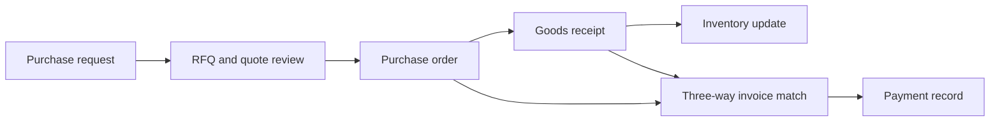

# FlowChain

**An independent procurement and inventory project for small and medium businesses, built by Zhixin Chen.**

FlowChain connects purchasing decisions with stock availability, supplier commitments, and the records behind them. Its assistant helps users understand what needs attention and prepares purchase-request and supplier-follow-up drafts for a person to review.

This repository presents the product, its business workflows, and recorded evaluation evidence. It does not contain the application source code or operational data.

## The procurement problem

A buyer needs to answer practical questions: What should we order? Will existing purchase orders cover the shortage? Which supplier needs a follow-up? The answers depend on inventory, reservations, inbound quantities, delivery dates, and supplier terms that often sit in separate records.

FlowChain brings these records together so users can move from a business question to an explanation, supporting evidence, and a proposed next step.

## Connected workflows

The product supports these workflows; not every purchase needs an RFQ. Payments made outside FlowChain are recorded in the system rather than executed by it.

## Three business scenarios

### Decide what needs replenishment

The reorder list combines on-hand stock, reservations, and remaining quantities on committed purchase orders. It uses 90 days of posted shipment history to estimate daily demand when sufficient history exists, then ranks items by when they need to be ordered relative to their recorded reorder points.

Incoming orders due after the calculated order-by date are excluded and the date is recalculated. Supplier minimum order quantities are considered when prefilling a purchase request. Missing data and incompatible units are shown explicitly instead of treated as valid inputs.

### Review supplier delivery performance

Supplier scorecards report on-time, in-full, and OTIF performance against the original promised date. Users can inspect the supporting purchase-order and receipt records, and see when the data is insufficient for a meaningful assessment.

### Prepare the next procurement action

The assistant answers questions about purchase orders, stock availability, supplier issues, and committed purchasing spend using workspace records. It links to the evidence and prepares purchase-request forms or supplier-follow-up drafts for human review. Existing orders that cover a shortage are surfaced before another request is proposed.

The assistant does not autonomously save, submit, approve, pay, or send messages.

## Recorded evaluation evidence

The assistant evaluation set contains **255 questions in English and Chinese**, covering business routing, numeric agreement, record lookup, follow-up context, permissions, tenant isolation, and draft preparation.

The recorded baseline dated **October 7, 2026** requires **225 cases to pass**. The project documentation reports that all 225 pass, with no permission leaks, cross-tenant leaks, or business writes in that evaluation. The remaining 30 cases are scored separately and are not part of the required gate; they include model-dependent planning, paraphrases, and semantic retrieval.

These results apply to the defined evaluation suite. They do not establish universal model accuracy or measured customer savings.

## My contribution

I developed FlowChain as an independent project, translating procurement and inventory requirements into connected product workflows. My work includes replenishment rules, supplier-performance analysis, an assistant grounded in business records, and evaluation cases that check the assistant's behavior against known data.

## Implementation overview

The application uses React, Node.js, PostgreSQL, and Prisma. Deterministic business services calculate quantities and amounts. An optional language model helps select read-only tools and word answers, while numerical claims are checked against the underlying records. The knowledge library supports document retrieval with citations.

Demand forecasting and MRP are outside the current product release. The replenishment workflow described here uses recorded inventory, purchase orders, and historical shipment data.

## Demonstration

See the [three-minute demonstration outline](DEMO.md) for a walkthrough of replenishment, supplier follow-up, and invoice matching. Demonstrations should use fictional records and an isolated demo workspace.

---

Prepared from the FlowChain main-branch snapshot `5f5fc580` on October 8, 2026. Product functionality, recorded evaluation results, and future work are described separately.
