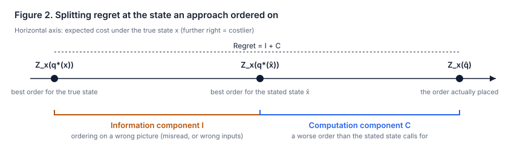
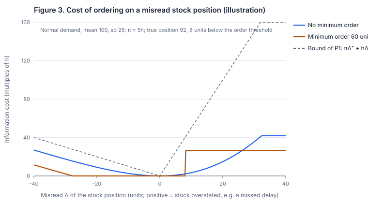
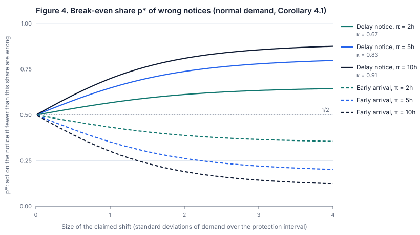
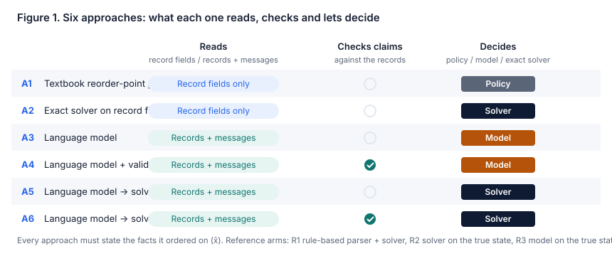

# From AI recommendations to operational decisions

**Misreading or miscalculating? Language models, exact solvers and supplier messages in replenishment**

*Research notes behind FlowChain. Zhixin Chen, MIT Supply Chain Management program, November 2026.*

*Status: an abstract (no. 159-0164) is submitted to the POMS 2027 Annual Conference, Information Systems and Operations Management track. The design below is being frozen into a pre-registration before any test run. No test results exist yet, and none are reported here; the numbers in Sections 5 and 7 are solver checks and development-window checks of the theory.*

The submitted abstract:

> AI-generated recommendations may overlook operational constraints across purchasing, inventory, and receiving. Using an integrated ERP testbed and publicly available synthetic enterprise data, we propose a controlled comparison of rule-based, language-model, and evidence-validated approaches to replenishment and supplier follow-up decisions, evaluating feasibility, constraint violations, and traceability.

Contents: [1 Question](#1-the-question) · [2 Related work](#2-related-work-and-positioning) · [3 Testbed](#3-testbed) · [4 Formal model](#4-formal-model) · [5 Propositions](#5-four-propositions) · [6 Study design](#6-study-design) · [7 Evidence so far](#7-evidence-so-far) · [8 Implications for deployment](#8-what-this-means-for-deploying-agents) · [References](#references)

---

## 1. The question

AI assistants are entering enterprise systems as advisers on routine operational decisions: what to reorder, which late purchase orders to chase. Their recommendations can look plausible and still miss a constraint recorded somewhere across purchasing, inventory and receiving. They can also rest on statements that were made but are not true.

Much of what changes a replenishment decision does not arrive as a record field. It arrives as text:

- a supplier writes that a shipment will slip two weeks;
- a buyer notes that a customer will double next month's order;
- a user asserts that a supplier always delivers early.

Rules and solvers read only fields. Language models read text but compute poorly. Wrong inputs are an old and measured problem in operations: at one retailer, about 65% of nearly 370,000 store inventory records did not match the physical stock (DeHoratius and Raman 2008). Much of what would correct the records arrives as text that the system cannot read, and language models can now read it. Supplier updates are already read by AI in commercial systems: the Procurement Agent in Microsoft Dynamics 365 Supply Chain Management sorts vendor emails into confirmations and change requests and links a revised delivery date to the purchase order for the buyer to accept (Microsoft Learn). Once accepted, that date is treated downstream as fact, although it is only the supplier's claim.

So the question is: **when an AI recommendation is costly, is it because the model read the situation wrong, or because it computed the decision wrong?** An illustrative case (not data):

| Approach | What it does with "the shipment will arrive about two weeks late" | Likely outcome |
| --- | --- | --- |
| Solver on the record fields | Cannot read it; treats the open order as arriving on time | No order; a shortage before the late order arrives |
| Language model alone | Reads it; orders "a bit more" by judgment | The right direction, the wrong quantity |
| Language model + solver | Moves the order's due date two weeks later, then re-solves | The right quantity for the delayed state |
| Any approach, given a false claim ("the supplier always delivers early") | — | Should check the claim against the delivery history before acting |

Three research questions follow.

- **RQ1.** How large is each approach's cost regret against the optimal decision, and how does it split between an information component and a computation component?
- **RQ2.** Does an exact solver in the loop remove the computation component? Does evidence validation remove the information component? Are the two complementary?
- **RQ3.** How much does changing the order on a supplier message save when the message is right, and cost when it is wrong? Does checking messages against the records give up the savings from true messages that the records do not show yet?

## 2. Related work and positioning

Two literatures meet here. Operations research has spent a decade questioning the seam between prediction and optimization: prescriptive analytics learns decisions from covariates directly (Bertsimas and Kallus 2020), and smart predict-then-optimize trains the predictor on the cost of the decision it feeds (Elmachtoub and Grigas 2022). Language models arrived from another side: as *modelers* that turn a verbal problem into a formulation (Ramamonjison et al. 2023; AhmadiTeshnizi, Gao and Udell 2024; Xiao et al. 2024), as *interfaces* to an optimizer (Li et al. 2023), and, with the same architecture trained on time series, as *forecasters* (Das et al. 2024; Ansari et al. 2024).

The closest work evaluates language-model agents in inventory control:

| Work | Setting | Main finding | What this study adds |
| --- | --- | --- | --- |
| Baek, Fu, Ma and Peng (2026), InventoryBench | Over 1,000 instances; OR, LLM, OR→LLM, LLM→OR; a classroom experiment | OR-augmented LLM beats either alone; human–AI teams beat either alone | The state is assembled from ERP records and messages, and some messages are false |
| Duan, Hu and Jiang (2026) | Human–LLM collaboration in inventory control | Perfect information alone does not close the gap; the bottleneck is computational | Tests whether that holds when information is soft and must be read from text |
| STOCKTAKE (2026) | LLM inventory agents against a Bayes oracle | Separates misreading the world from failing to act on it | The same split against an exact optimum with minimum orders, a budget and many items |
| AIM-Bench (2025) | LLM inventory agents under stochastic lead times | Decision biases against optimal actions | Records and messages instead of a stated environment |
| Drossman, Jacquillat and Martin (2026) | LLM agents in interactive optimization with simulated stakeholders | Conversation finds better solutions than a single shot | Stakeholders who hold information that may be true or false, not only hidden preferences |
| Atasoy, Güllü and Tan (2012) | Inventory control with advance supply information | State-dependent base-stock policies; value of information computed numerically | Supply information arrives as a message that may be wrong; P2 and P4 give when acting on it still pays |

None of these scores the decision to act on an unverifiable supplier claim against an exact optimum, with true and false twins of the same claim.

## 3. Testbed

The testbed is FlowChain, the ERP described in this repository. For the study it turns each public-data scenario into ERP records and runs every approach on the same records.

- **The ERP.** Purchasing, receiving, inventory, sales and payables share one set of records. The assistant reads them through read-only tools; any change it proposes goes through a card that a person confirms.
- **The solver.** A sample-average-approximation mixed-integer program, solved exactly with HiGHS (Huangfu and Hall 2018). It reads its inputs from the records: the inventory position, the preferred supplier's lead time, minimum order and reference price, and 90 days of shipments turned into 200 demand scenarios over the lead time plus a 7-day review period. It weighs holding against shortage within a budget and the minimum orders, and costs its plan beside ordering nothing and beside any plan the user proposes. Holding cost (25% a year) and shortage cost (5× holding) are labelled assumptions.
- **Logging.** Every solver call records the full result and exactly what the model was shown. The decomposition below needs this, because it compares the state an approach ordered on with the true state.
- **Reproduction.** On the same exported data, the in-product solver matches the offline research prototype to the cent.
- **Still to build:** a due-date override with the window rule (10), so that "two weeks late" can move an open order out of the protection interval; an instance generator; a message generator; and a true-state simulator.

## 4. Formal model

The model has three parts: a decision problem with an exact optimum, an information layer that separates what is true from what an approach sees and orders on, and scores that compare the two.

### 4.1 Decision problem

Items are $`i = 1,\dots,n`$. The decision is an order quantity $`q_i`$ for each item now, with $`z_i = 1`$ if item $`i`$ is ordered. The true state $`x`$ fixes each item's inventory position $`I_i(x)`$, unit price $`c_i`$, supplier minimum $`q_i^{\min}`$, lead time $`L_i`$, and demand $`D_i`$ over the protection interval $`L_i + R`$ with $`R = 7`$ review days. Holding cost $`h_i = 0.25\,c_i (L_i + R)/365`$ and shortage cost $`\pi_i = 5h_i`$ are labelled assumptions; $`B`$ is the budget for this order.

```math
Z_x(q) = \sum_{i=1}^{n} \mathbb{E}\left[ h_i\,\big(I_i(x) + q_i - D_i\big)^+ + \pi_i\,\big(D_i - I_i(x) - q_i\big)^+ \right] \qquad (1)
```

```math
\mathcal{Q} = \left\{ q \in \mathbb{Z}_{\ge 0}^{n} \;:\; q_i^{\min} z_i \le q_i \le M_i z_i,\; z_i \in \{0,1\},\; \sum_i c_i q_i \le B \right\} \qquad (2)
```

```math
q^{\ast}(x) = \arg\min_{q \in \mathcal{Q}} Z_x(q) \qquad (3)
```

(1) has no purchase term because leftover stock carries over; purchase cost enters through $`h_i`$ and $`B`$. The solver computes (3) exactly on $`N = 200`$ demand scenarios $`D_{ik}`$, built by a 7-day block bootstrap of recorded shipments:

```math
\min_{q,z,u,v}\; \frac{1}{N}\sum_{k=1}^{N}\sum_{i=1}^{n}\left(h_i u_{ik} + \pi_i v_{ik}\right) \qquad (4)
```

```math
u_{ik} \ge I_i + q_i - D_{ik}, \qquad v_{ik} \ge D_{ik} - I_i - q_i, \qquad u_{ik}, v_{ik} \ge 0 \qquad (5)\text{–}(6)
```

```math
q_i^{\min} z_i \le q_i \le M_i z_i, \qquad \sum_i c_i q_i \le B \qquad (7)\text{–}(8)
```

```math
q_i \in \mathbb{Z}_{\ge 0}, \qquad z_i \in \{0,1\} \qquad (9)
```

with $`M_i = \min\left(\lfloor B/c_i \rfloor,\, \max\left(\max_k D_{ik} - I_i,\; q_i^{\min}\right)\right)`$: an order beyond the largest sampled demand only adds holding cost, so the bound removes no optimal order. HiGHS solves (4)–(9) to a relative gap of at most $`10^{-6}`$. Constraints (7)–(8) live inside the solver tool, so a language model that calls it cannot drop them.

### 4.2 Records, messages and the state used to order

An approach never sees $`x`$. It sees records that can lag the truth and messages that can be wrong, and it must state the state it orders on. For item $`i`$, with on hand $`s_i`$, reserved $`r_i`$ and open order lines $`j \in J_i`$ with remaining quantity $`a_j`$ and true due day $`d_j`$, the position counts only the lines that arrive within the protection interval:

```math
I_i(x) = s_i - r_i + \sum_{j \in J_i:\; d_j \le L_i + R} a_j \qquad (10)
```

A delay therefore matters: it can push a line out of the window and lower $`I_i`$. The records $`x^{\mathrm{rec}} = \rho(x)`$ carry the recorded due days and lead times, which can lag. A message $`m`$ makes a claim $`\tilde\theta_m`$ about one component $`\theta_m(x)`$ of the state:

```math
m = \big(\theta_m,\; \tilde\theta_m,\; \tau_m,\; \chi_m\big), \qquad \tau_m \in \{\text{true},\, \text{false},\, \text{vague}\}, \quad \chi_m \in \{\text{checkable},\, \text{not checkable}\} \qquad (11)
```

A true claim equals $`\theta(x)`$, which the records do not show yet ("your open order will arrive two weeks late"); a false one differs ("Acme always delivers early"); a vague one contains $`\theta(x)`$ in a range ("the order may be delayed"). A message is checkable when the records hold evidence about it, such as the supplier's delivery history. An approach $`\omega`$ reads, then decides:

```math
\hat x_\omega = \mathrm{read}_\omega\big(x^{\mathrm{rec}}, M\big) \qquad (12) \qquad\qquad \hat q_\omega = g_\omega\big(\hat x_\omega\big) \qquad (13)
```

For the solver arms $`g_\omega = q^{\ast}(\cdot)`$. Every approach must output $`\hat x_\omega`$ as structured facts, each tied to a record or a message, so (12) and (13) are observable. Validation adopts a checkable claim only when the records support it; a claim that cannot be checked is adopted or not by a stated rule that is part of the arm's design.

### 4.3 Scoring

Every score is computed under the true state $`x`$, with expectations estimated on 20,000 held-out demand samples, not the $`N`$ used to solve. Regret splits exactly at the stated state:

```math
\underbrace{Z_x(\hat q_\omega) - Z_x\big(q^{\ast}(x)\big)}_{\text{regret}} \;=\; \underbrace{Z_x\big(q^{\ast}(\hat x_\omega)\big) - Z_x\big(q^{\ast}(x)\big)}_{\text{information } \mathcal{I}_\omega} \;+\; \underbrace{Z_x(\hat q_\omega) - Z_x\big(q^{\ast}(\hat x_\omega)\big)}_{\text{computation } C_\omega} \qquad (15)
```



$`\mathcal{I}_\omega \ge 0`$ (up to sampling error), because $`q^{\ast}(\hat x_\omega) \in \mathcal{Q}`$ and $`q^{\ast}(x)`$ is the best point of $`\mathcal{Q}`$ under $`x`$. $`C_\omega`$ can be negative, when a computing error happens to offset a reading error, so it is the contribution of the computation deviation at true cost, not a pure measure of miscomputing; the paper also reports the computing error judged in the approach's own stated state, $`C^{\mathrm{own}}_\omega = Z_{\hat x}(\hat q_\omega) - Z_{\hat x}(q^{\ast}(\hat x_\omega))`$. For the solver arms $`C_\omega = 0`$ by construction, when the order comes from a valid solver call. Because (15) charges reading first, an order-independent (Shapley) version averaging both orders is reported beside it, using the reference arm R3 for the order an approach would place on the true state.

Three further scores make results comparable with Drossman et al. (2026):

```math
S_\omega = \begin{cases} Z_x(q^{\ast}(x)) / Z_x(\hat q_\omega) & \hat q_\omega \in \mathcal{Q} \\ 0 & \text{otherwise} \end{cases}, \qquad \text{success}_\omega = \mathbb{1}\left[\hat q_\omega \in \mathcal{Q},\; Z_x(\hat q_\omega) \le (1+\varepsilon)\, Z_x(q^{\ast}(x))\right] \qquad (16)
```

```math
\mathrm{FA}_\omega = \Pr\left[\text{claim adopted} \mid \tau = \text{false}\right], \qquad \mathrm{TU}_\omega = \Pr\left[\text{claim used} \mid \tau = \text{true}\right] \qquad (17)
```

```math
V_\omega = Z_x\big(\hat q_{\mathrm{A2}}\big) - Z_x\big(\hat q_\omega\big) \qquad (18)
```

$`V_\omega`$ is what reading the messages was worth to approach $`\omega`$, in dollars, against the solver on record fields alone (A2); it is negative when messages hurt. Traceability is the share of figures in an answer that match a record, a message or a solver output, checked by exact matching.

## 5. Four propositions

Four short results predict where reading errors cost most and when acting on a message pays off. The experiment then tests them on the study's instances.

**Proposition 1 (misreading stock costs asymmetrically).** One item, no binding minimum or budget, correct demand distribution. If an approach misreads the position as $`\hat I_i = I_i + \Delta_i`$ and the solver orders for that position, then

```math
\mathcal{I}_i \;\le\; \pi_i\,\Delta_i^{+} + h_i\,\Delta_i^{-}.
```

The cost (1) is convex in the stock after the order, with slopes between $`-\pi_i`$ and $`h_i`$; the solver orders up to its target for the misread position, so the true stock ends $`\Delta_i`$ below the target. Overstating stock (missing a delay) costs up to $`\pi_i`$ per unit; understating it costs at most $`h_i`$. With $`\pi_i = 5h_i`$, a missed delay can cost five times as much per unit as a false alarm.

**Proposition 2 (when ordering on an unverifiable message pays).** A message, if right, puts the state at $`x_T`$; if wrong, the records are right. Let $`p`$ be the share of such messages that are wrong, $`G`$ what ordering on the message saves when it is right and $`L`$ what it costs when it is wrong. Then

```math
\text{order on the message} \iff p\,L < (1-p)\,G \iff p < p^{\ast} = \frac{G}{G+L}.
```

**Proposition 3 (minimum orders amplify small misreads).** With a minimum order and no binding budget, the order is $`0`$ or at least $`q_i^{\min}`$, and the solver orders when the position is below a threshold $`I_i^{t}`$. A misread that crosses $`I_i^{t}`$ swaps the two choices, and

```math
\mathcal{I}_i \;\le\; (\pi_i + h_i)\,\lvert \Delta_i \rvert .
```

Without a minimum, a small misread near the target costs almost nothing. With one, a small misread can flip the order between nothing and a whole lot, and understating stock can cost up to $`\pi_i + h_i`$ per unit, six times $`h_i`$ at $`\pi_i = 5h_i`$. The asymmetry of P1 fades: where minimum orders bind, a delay notice needs checking too.



*Figure 3 illustrates P1 and P3 on one item with normal demand (mean 100, sd 25 over the protection interval, $`\pi = 5h`$). The true position sits 8 units below the order threshold. Without a minimum, an 8-unit overstatement costs about $`2h`$; with a minimum of 60 units it flips the order from a full lot to nothing and costs about $`27h`$.*

**Proposition 4 (where the break-even share lies).** One item, no binding minimum or budget, both states calling for a positive order. Let $`F, f`$ be the distribution and density of demand over the protection interval, $`\kappa = \pi_i/(\pi_i + h_i)`$ the critical ratio and $`y^{\ast} = F^{-1}(\kappa)`$ the order-up-to level. A delay notice says the true position is $`\delta > 0`$ below the records; an early-arrival notice says it is $`\delta`$ above. With $`\Gamma(y)`$ the expected cost of ending at stock $`y`$,

```math
p^{\ast}_{\text{delay}} = \frac{\Gamma(y^{\ast}-\delta) - \Gamma(y^{\ast})}{\Gamma(y^{\ast}-\delta) + \Gamma(y^{\ast}+\delta) - 2\Gamma(y^{\ast})}, \qquad p^{\ast}_{\text{early}} = 1 - p^{\ast}_{\text{delay}} .
```

Near $`y^{\ast}`$ both gains grow like $`\tfrac12 (h+\pi) f(y^{\ast}) \delta^2`$, so $`p^{\ast} \to 1/2`$; far from it the gain grows like $`\pi\delta`$ and the loss like $`h\delta`$, so $`p^{\ast}_{\text{delay}} \to \kappa`$. And $`p^{\ast}_{\text{delay}} \ge 1/2`$ exactly when

```math
\int_0^{\delta} \left[\, 2\kappa - F(y^{\ast}-t) - F(y^{\ast}+t) \,\right] dt \;\ge\; 0,
```

which holds for every $`\delta`$ when demand is symmetric and unimodal and $`\kappa \ge 1/2`$. In words: when these conditions hold, act on a delay notice unless more than a share between $`1/2`$ and $`\kappa`$ of such notices are wrong, and act on an early-arrival notice only if fewer than a share between $`1-\kappa`$ and $`1/2`$ are wrong. With $`\pi = 5h`$, $`\kappa = 0.83`$. The band is not universal: with a heavy right tail, a delay notice can be worth acting on even when more than $`\kappa`$ of such notices are wrong.

**Corollary 4.1 (normal demand).** For demand $`N(\mu, \sigma^2)`$, a shift of $`u`$ standard deviations, $`z = \Phi^{-1}(\kappa)`$ and the standard normal loss function $`L_o`$,

```math
p^{\ast}_{\text{delay}}(u) = \frac{-(1-\kappa)\,u + L_o(z-u) - L_o(z)}{L_o(z-u) + L_o(z+u) - 2L_o(z)},
```

which depends only on $`\kappa`$ and $`u`$ and, for $`\kappa > 1/2`$, rises strictly from $`1/2`$ to $`\kappa`$ (for example $`0.629`$ at $`\kappa = 0.8`$, $`u = 1`$).



**With a binding budget.** Let $`\lambda`$ be the budget's shadow price. Units moved to item $`j`$ on a message cost the other items about $`\lambda c_j`$ per unit whether the message is right or wrong, so the critical ratio becomes $`\kappa_\lambda = \kappa - \lambda c_j/(\pi + h)`$, and for symmetric unimodal demand the direction reverses, to first order, when $`\lambda c_j > (\pi - h)/2`$. Under a tight budget a delay notice is worth less, because the money for extra units comes out of other items, and an early-arrival notice is worth more. This version is a local approximation and is reported as a diagnostic, not a guarantee.

Two planned tests follow from the propositions, and both test the cost structure on the study's instances rather than agent behaviour: **H4**, a minimum order raises the information cost per misread unit, more for understated than for overstated stock (re-solving each run's stated and true states without the minimum, no model calls); and **H5**, under a loose budget, $`p^{\ast}`$ is higher for delay notices than for early-arrival notices (computed from the solver alone).

## 6. Study design

### 6.1 Approaches



Every approach sees the same records and messages, except by design, and states the facts it acted on; each decision is scored on the true state. Three reference arms bracket them: **R1**, a rule-based message parser feeding the solver (does a structured channel do as well as a language model?); **R2**, the solver on the true state (regret 0 by definition); and **R3**, a language model given the true state (computing on correct records). Every model arm is reported against A2 and R1, and the paper says plainly where a model arm does not beat R1.

### 6.2 Data, windows and scenarios

Demand comes from public data under CC BY 4.0: M5 (Walmart, daily unit sales by store and item, with shelf prices; Makridakis, Spiliotis and Assimakopoulos 2022) and Online Retail II (a UK online retailer's invoice lines; Chen 2019). The supply side and the messages are simulated on top, each parameter set from a published figure where one exists and labelled an assumption where none does:

| Parameter | Value | Basis |
| --- | --- | --- |
| Share of open orders that arrive late | 10–20% domestic; about 40% for ocean imports | Supplier on-time delivery has a median of 90% across 4,648 companies (APQC); global container schedule reliability was 61.4% in October 2025 (Sea-Intelligence) |
| Errors in recorded on-hand stock | A robustness condition | About 65% of store records inaccurate (DeHoratius and Raman 2008) |
| Lead time | 14 days; 7 and 28 in sensitivity runs | Assumption |
| Minimum order | A week of mean demand, rounded up to 10; half and double in sensitivity runs | Assumption |
| Holding cost | 25% of item value a year; 15–35% in sensitivity runs | Common textbook and practitioner value |
| Shortage cost | 5× holding (83% cycle service); 2× and 10× in sensitivity runs | Assumption |
| Share of true, false and vague messages | Set by the design | An experimental factor, not a property of the world |

Each scenario is a set of items at one decision date, with 90 days of demand history. A **training window** of earlier dates fixes the item-selection rule, the demand-scenario method and the prompts and hosts the pilot; nothing in it counts as a result. A **test window** of later dates stays untouched until the registered runs. Scores are realized cost on the demand that actually followed each decision (a backtest) and, as a check, expected cost (1) under the demand model. The main results on M5 are repeated on Online Retail II. No model is fine-tuned.

### 6.3 Experiment 1: messages as the main factor

| Message condition | Test scenarios | What it measures |
| --- | --- | --- |
| None (planning from the records only) | 40 | Computation, $`C`$ in (15) |
| True, e.g. "your open order will arrive two weeks late" | 60 | Using true information: TU (17), $`V`$ (18) |
| False, the twin of a true message | 60 | Ordering on wrong messages: FA (17) |
| Vague, e.g. "the order may be delayed" | 40 | Behaviour when the message is unclear |

The 60 false-message scenarios are **twins** of the 60 true ones: each pair shares the message, stock, open orders, sales history and budget and differs only in the truth (and, when the claim is checkable, in the supplier's receipt history, since that is the evidence a check can find). Within true and false, half of the messages are checkable and half are not, and independently half lower the stock position (a delay) and half raise it (an early arrival). All six approaches run on every test scenario, so they are compared in pairs. A seventh arm (A7) adds one line giving the supplier's track record of wrong notices, at one level below and one above each pair's $`p^{\ast}`$, to see whether adoption responds to the record.

**Sample size.** What matters is the number of distinct scenarios, not total conversations. The key paired comparison (for example FA of A5 against A6 on the same false messages) is a McNemar test; at a 5% level and 80% power it needs

```math
n = \frac{\left(z_{\alpha/2}\sqrt{p_d} + z_{\beta}\sqrt{p_d - \delta^2}\right)^2}{\delta^2}
```

pairs, where $`\delta`$ is the difference to detect and $`p_d`$ the share of discordant pairs: about 56 pairs for $`\delta = 20`$ points at $`p_d = 30\%`$, and about 154 for $`\delta = 10`$ points at $`p_d = 20\%`$. The pilot estimates $`\delta`$ and $`p_d`$; if more than 60 twin pairs are needed, the twins grow (for example 150 pairs gives 380 test scenarios).

**Models (planned).** Two hosted models, Claude Sonnet 5.5 and GPT-5.5 through MIT's gateway, and one open-weight model (for example from the Qwen3 family) on MIT GPUs, with versions, weights and sampling settings pinned. The model comparison is a robustness check; the main comparison is across approaches. Every run logs its inputs, outputs, tool calls, stated state, tokens, cost and model version.

**Pre-specified estimates and tests.** E1: the size of $`C`$ for the model arms that compute their own order. E2–E3: $`\mathcal{I}`$ against $`C`$ on message scenarios, and $`V`$ for A5 and A6 on true and false messages, traced over the share $`p`$ of false messages. H2 (a design check): validation lowers FA and, when true messages are not checkable, also lowers TU. E4: without a checking tool, whether the model adopts the true twin more often than the false one. E5: the model's adoption of delay versus early-arrival notices against the break-even rule of P2/P4. E6: whether adoption changes with the stated track record (A7). H4 and H5 as in Section 5, Holm-corrected. Every estimate is reported whatever its sign.

### 6.4 Experiment 2 (later): conversations with simulated buyers

Experiment 2 carries the design of Drossman, Jacquillat and Martin (2026) into supply chains and adds what they set aside: buyers whose private information may be wrong. A simulated buyer has hidden weights on cost, service on priority items and spend, communicates vaguely or precisely, gives binary or rich feedback, and holds no private information, true information or false information. The assistant writes its own MILP code or calls the solver tool, with and without a validation tool. Regret then splits three ways: misjudged preferences, a misread state and computation.

### 6.5 Validity

- **Objective scoring.** Every score in (15)–(18) is computed by the simulator against the known true state; no person or language model grades an answer. Traceability is checked by exact matching. Synthetic scenarios are generated fresh, so they cannot appear in a model's training data.
- **The benchmark's own error.** $`q^{\ast}(x)`$ is optimal for 200 sampled demand paths, not the distribution itself. For one scenario per cell, $`q^{\ast}`$ is held fixed and compared with the optimum of 20 independent batches; the mean gap plus $`t_{0.95,19}`$ standard errors bounds its optimality gap (Mak, Morton and Wood 1999).
- **Mechanism, not only scores.** Each failed run gets one of six error types (misread a record, accepted a false claim, ignored a true message, broke a constraint, computed badly, stated an unsupported figure), coded by script and double-coded by hand on a 10% sample (Cohen's κ reported). Severe losses are reported as the 90th and 95th percentiles of regret.
- **Reproducibility.** Code, scenario generator, seeds, prompts and the full log of every model call are to be released with a DOI; every score can be recomputed from the logs without calling a model.

## 7. Evidence so far

Only the solver has been piloted, on public data; no comparison of the approaches has been run, and no model was involved in any number below.

- **Solver checks (M5, six FOODS_3 items, store CA_1, run before the training and test windows were fixed; they verify the solver only).** HiGHS reports an optimal solution with a gap of 0, with and without the budget. Without a budget or minimums, the solver matches the newsvendor solution at shortage-to-holding ratios of 2, 5 and 10. At the budget, the held-out cost is within 0.6% of the in-sample cost. The same checks were run on a second M5 department with intermittent demand and on Online Retail II.
- **P3 on a development scenario (M5, training window).** Worst cost per misread unit, in multiples of $`h_i`$, for misreads of 1 to 60 units, against the bound of 6:

| Item and minimum order | Overstated stock: no minimum → minimum | Understated stock: no minimum → minimum |
| --- | --- | --- |
| FOODS_3_226, 360 units | 0.57 → 4.89 | 0.43 → 3.87 |
| FOODS_3_586, 120 units | 1.12 → 4.28 | 0.54 → 2.42 |
| FOODS_3_226, 720 units (sensitivity) | 0.56 → 5.86 | 0.42 → 5.66 |

- **P4 on development twin pairs.** With a loose budget, 16 of 16 twin pairs on M5 and 15 of 16 on Online Retail II fall inside the bands of P4, although those scenarios include minimum orders and 3–6 items. Under a tight budget the bands fail (4 of 16 on M5, 9 of 16 on Online Retail II): the budget, not the cost slopes, then decides what a message is worth, and that case stays exploratory.

## 8. What this means for deploying agents

The design choices in FlowChain follow from the same reasoning, before any experiment confirms it:

1. **Keep the model off the arithmetic.** The language model never produces a decision quantity in the product; quantities come from rules or the exact solver, and constraints live inside the solver tool, where a model cannot drop them. That sets the computation component to zero by construction for the decisions that matter, and confines the model's errors to the stated state, where they can be checked.
2. **Make the stated state visible.** Every answer is checked against the records the model read, so what the model *believed* is inspectable. The study requires the same of every approach, because the regret split needs it.
3. **Check claims, but know what checking costs.** Validation protects against false claims and can also discard true news that the records do not show yet. P2 and P4 say when acting on an unverifiable notice still pays: readily for a delay notice when minimum orders and budgets are slack, with checking when they bind.
4. **Measure against a known truth.** A seeded workspace whose true state is known is what makes "the agent was right" a measurement rather than an impression. The product's question set (see the README) applies the same principle to everyday questions.

## References

AhmadiTeshnizi, A., Gao, W. and Udell, M. (2024). OptiMUS: Scalable optimization modeling with (MI)LP solvers and large language models. *Proceedings of the 41st International Conference on Machine Learning (ICML)*.

Ansari, A. F. et al. (2024). Chronos: Learning the language of time series. *Transactions on Machine Learning Research*.

Atasoy, B., Güllü, R. and Tan, T. (2012). Optimal inventory policies with non-stationary supply disruptions and advance supply information. *Decision Support Systems* 53(2), 269–281.

Baek, Fu, Ma and Peng (2026). AI agents for inventory control: Human–LLM–OR complementarity. arXiv:2602.12631.

Bertsimas, D. and Kallus, N. (2020). From predictive to prescriptive analytics. *Management Science* 66(3), 1025–1044.

Chen, D. (2019). Online Retail II [Dataset]. UCI Machine Learning Repository. https://doi.org/10.24432/C5CG6D

Das, A., Kong, W., Sen, R. and Zhou, Y. (2024). A decoder-only foundation model for time-series forecasting. *Proceedings of the 41st International Conference on Machine Learning (ICML)*.

DeHoratius, N. and Raman, A. (2008). Inventory record inaccuracy: An empirical analysis. *Management Science* 54(4), 627–641.

Drossman, Jacquillat and Martin (2026). Let's have a conversation. Working paper, arXiv:2604.02666.

Duan, Hu and Jiang (2026). Ask, clarify, optimize. Working paper, arXiv:2601.00121.

Elmachtoub, A. N. and Grigas, P. (2022). Smart "predict, then optimize". *Management Science* 68(1), 9–26.

Huangfu, Q. and Hall, J. A. J. (2018). Parallelizing the dual revised simplex method. *Mathematical Programming Computation* 10(1), 119–142.

Li, B., Mellou, K., Zhang, B., Pathuri, J. and Menache, I. (2023). Large language models for supply chain optimization. arXiv:2307.03875.

Mak, W.-K., Morton, D. P. and Wood, R. K. (1999). Monte Carlo bounding techniques for determining solution quality in stochastic programs. *Operations Research Letters* 24(1–2), 47–56.

Makridakis, S., Spiliotis, E. and Assimakopoulos, V. (2022). M5 accuracy competition: Results, findings, and conclusions. *International Journal of Forecasting* 38(4), 1346–1364.

Microsoft (2026). Procurement Agent in Dynamics 365 Supply Chain Management. Microsoft Learn documentation, accessed November 2026.

Ramamonjison, R. et al. (2023). NL4Opt competition: Formulating optimization problems based on their natural language descriptions. *Proceedings of the NeurIPS 2022 Competitions Track*, PMLR 220, 189–203.

STOCKTAKE (2026). arXiv:2607.13618.

AIM-Bench (2025). arXiv:2508.11416.

Xiao, Z. et al. (2024). Chain-of-Experts: When LLMs meet complex operations research problems. *International Conference on Learning Representations (ICLR)*.
